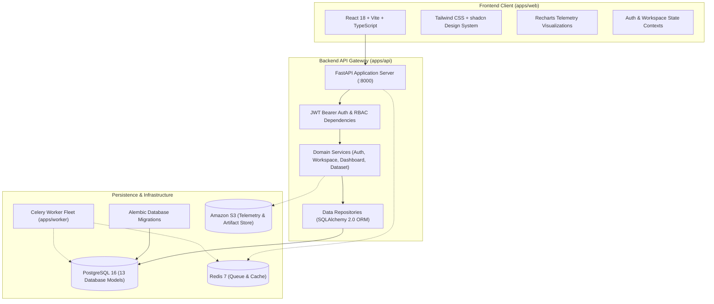

# NexusMind AI

> **NexusMind AI: An AI-Driven Cloud Intelligence and Resource Optimization Platform Using Big Data Analytics, Generative AI, Reinforcement Learning, Advanced Machine Learning, and AWS**

[](https://github.com/nexusmind/nexusmind-ai/actions)
[](https://opensource.org/licenses/MIT)
[](https://python.org)
[](https://fastapi.tiangolo.com)
[](https://react.dev)
[](https://www.typescriptlang.org)
[](https://tailwindcss.com)
[](https://www.postgresql.org)
[](https://www.docker.com)

---

## 1. Project Overview & Vision

**NexusMind AI** is an enterprise-grade cloud intelligence SaaS platform architected for modern organizations running high-density microservices and distributed workloads. The platform tackles cloud over-provisioning and operational blind spots by unifying:
1. **Software Project Management (SPM):** Agile governance, sprint tracking, risk matrices, and task kanban workflows.
2. **Big Data Analytics:** Telemetry characterization, statistical profiling, and anomaly clustering over large workload datasets.
3. **Advanced Machine Learning:** Multi-horizon demand forecasting using LSTM neural networks, ARIMA, and Prophet.
4. **Reinforcement Learning (RL):** Continuous policy optimization (PPO) balancing compute cost reduction against strict 99.9% application SLAs.
5. **Generative AI:** Autonomous cloud operations copilot for natural language diagnosis and automated report generation.
6. **AWS Cloud Computing:** Cloud-native architecture targeting Amazon ECS, Aurora PostgreSQL, S3, and CloudWatch.

---

## 2. Six-Phase Development Roadmap

| Phase | Description | Status |
|---|---|---|
| **Phase 1** | **Enterprise Foundation, Architecture & UI Development** | **CURRENT RELEASE** |
| **Phase 2** | Workload Data Collection, Ingestion Pipelines & Storage | *Planned* |
| **Phase 3** | Big Data Analytics Engine & Workload Characterization | *Planned* |
| **Phase 4** | Advanced Machine Learning Demand Forecasting | *Planned* |
| **Phase 5** | Reinforcement Learning Resource Optimization | *Planned* |
| **Phase 6** | Generative AI Cloud Copilot & AWS Cloud Deployment | *Planned* |

> **Phase 1 Integrity Notice:** In Phase 1, all telemetry values and charts are clearly badged as **DEMO DATA** to validate UI and architectural workflows without making false claims of live cloud metrics.

---

## 3. System Architecture



---

## 4. Repository & Monorepo Structure

```text
nexusmind-ai/
├── apps/
│   ├── web/                     # React 18 + TypeScript + Vite + Tailwind CSS + Recharts
│   │   ├── src/
│   │   │   ├── components/      # UI components, layout shell, auth guards, dashboard widgets
│   │   │   ├── contexts/        # AuthContext, WorkspaceContext, ThemeContext
│   │   │   ├── lib/             # API client, utilities, storage helpers
│   │   │   ├── pages/           # Landing, Login, Register, Onboarding, and 10 Module Pages
│   │   │   └── types/           # Core TypeScript data contracts
│   │   ├── index.html
│   │   ├── package.json
│   │   ├── tailwind.config.js
│   │   └── vite.config.ts
│   │
│   ├── api/                     # Python 3.11 FastAPI Backend
│   │   ├── alembic/             # Database versioning & migration scripts
│   │   ├── app/
│   │   │   ├── api/v1/          # Versioned REST API endpoints (auth, workspaces, dashboard, etc.)
│   │   │   ├── core/            # Config, JWT security, logging, error handling
│   │   │   ├── db/              # SQLAlchemy 2.0 engine, sessions, seed initializers
│   │   │   ├── dependencies/    # Auth token verification & RBAC role checkers
│   │   │   ├── models/          # 13 SQLAlchemy domain entities & Enums
│   │   │   ├── repositories/    # Clean data access layer isolating ORM queries
│   │   │   ├── schemas/         # Pydantic v2 validation contracts
│   │   │   └── services/        # Decoupled business logic layer
│   │   ├── tests/               # Automated Pytest suite (health, auth, workspaces, rbac)
│   │   ├── alembic.ini
│   │   └── requirements.txt
│   │
│   └── worker/                  # Background worker skeleton
│       ├── app/main.py
│       ├── Dockerfile
│       └── requirements.txt
│
├── packages/
│   └── shared/                  # Shared TypeScript constants, enums, and types
│
├── infrastructure/
│   ├── docker/                  # Dockerfile.api, Dockerfile.web, nginx.conf
│   └── aws/                     # Architecture manifests & IAM specifications
│
├── docs/
│   ├── architecture/            # Architectural topology and Mermaid diagrams
│   ├── api/                     # OpenAPI specifications and REST endpoints
│   └── spm/                     # 12 Professional SPM deliverables:
│       ├── 01-project-charter.md
│       ├── 02-project-scope.md
│       ├── 03-functional-requirements.md
│       ├── 04-non-functional-requirements.md
│       ├── 05-work-breakdown-structure.md
│       ├── 06-agile-sprint-plan.md
│       ├── 07-milestone-plan.md
│       ├── 08-risk-register.md
│       ├── 09-quality-assurance-plan.md
│       ├── 10-testing-strategy.md
│       ├── 11-project-timeline.md
│       └── 12-resource-planning.md
│
├── scripts/                     # Local startup & test execution scripts
├── .github/workflows/ci.yml     # Automated CI pipeline
├── .env.example                 # Configuration template
├── .gitignore
├── docker-compose.yml           # Multi-container orchestration (web, api, postgres, worker, redis)
└── README.md
```

---

## 5. Prerequisites

- **Python:** 3.11 or higher
- **Node.js:** 20.x or higher (npm 10+)
- **Docker & Docker Compose:** Optional for local containerization
- **Git**

---

## 6. Local Quickstart (Without Docker)

### Step 1: Environment Setup
```bash
# Clone repository
git clone <repository_url>
cd "NexusMind AI"

# Copy environment template
cp .env.example .env
```

### Step 2: Backend Setup
```bash
# Create and activate virtual environment (optional but recommended)
python -m venv venv
# Windows:
.\venv\Scripts\activate
# Linux/Mac:
source venv/bin/activate

# Install dependencies
pip install -r apps/api/requirements.txt

# Run initial database migration (SQLite dev database initialized automatically)
alembic -c apps/api/alembic.ini upgrade head

# Start FastAPI server
uvicorn apps.api.app.main:app --host 0.0.0.0 --port 8000 --reload
```
API Documentation will be live at: `http://localhost:8000/docs`

### Step 3: Frontend Setup
```bash
cd apps/web

# Install frontend dependencies
npm install

# Start Vite dev server
npm run dev
```
Open your browser at `http://localhost:5173`

---

## 7. Pre-Seeded Evaluation Credentials

For immediate Phase 1 evaluation without manual registration:
- **Email:** `admin@nexusmind.ai`
- **Password:** `NexusAdmin@2026`
- **Role:** Platform Administrator & Workspace Administrator
- **Default Workspace:** Cloud Intelligence Demo

---

## 8. Docker Compose Deployment

To build and run the full stack with PostgreSQL, Redis, FastAPI, Celery worker, and Nginx:
```bash
# Start all containers in background
docker compose up --build -d

# Check container status
docker compose ps

# View unified logs
docker compose logs -f
```
- **Web App (Nginx):** `http://localhost:3000`
- **Backend API:** `http://localhost:8000`
- **PostgreSQL:** Port `5432`
- **Redis:** Port `6379`

---

## 9. Automated Testing

### Backend Unit & Integration Tests (Pytest)
```bash
# Run pytest with in-memory test database
pytest apps/api/tests/ -v
```

### Frontend Typechecking & Production Build
```bash
cd apps/web
npm run build
```

---

## 10. Security & Role-Based Access Control (RBAC)

NexusMind AI enforces a 4-tier hierarchy:
1. **Platform Administrator:** Global system configuration, user lifecycle, platform-wide audit access.
2. **Workspace Administrator:** Member invitations, workspace telemetry policies, dataset registration.
3. **Analyst:** Dataset inspection, model experimentation, report generation.
4. **Viewer:** Read-only access to authorized dashboards and published reports.

All authorization checks are enforced server-side via FastAPI dependency injection (`require_workspace_role`). Passwords are encrypted using salted bcrypt hashing.

