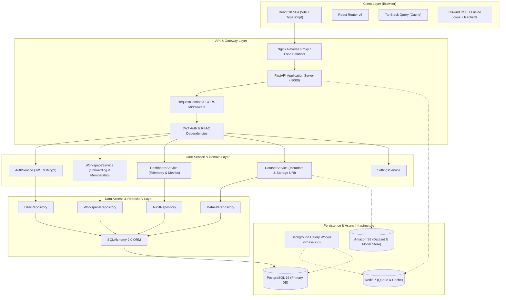

# NexusMind AI - System Architecture (Phase 1 Baseline)

## Architecture Overview

NexusMind AI is architected as a modular, cloud-native, multi-tier enterprise SaaS platform designed to scale from single-developer local containerized environments up to multi-region AWS cloud deployments.

---

## Key Architectural Principles

1. **Strict Multi-Tenancy & Workspace Isolation**: Every domain model links to a `workspace_id`. Cross-workspace queries are strictly prohibited through repository encapsulation and dependency verification.
2. **Layered Decoupling**: API routers only handle protocol concerns (HTTP request parsing, status codes, OpenAPI serialization). All business rules live in dedicated services; all persistence interactions live in repositories.
3. **Transparent Demo Separation**: Telemetry data during Phase 1 is clearly labeled with `is_demo_data: true` and UI badges, ensuring that mock previews never masquerade as live cloud infrastructure.
4. **Cloud-Ready Hybrid Storage**: Metadata resides in PostgreSQL while large telemetry binary/CSV payloads are pointed to S3 storage URIs without bloat in the relational database.

